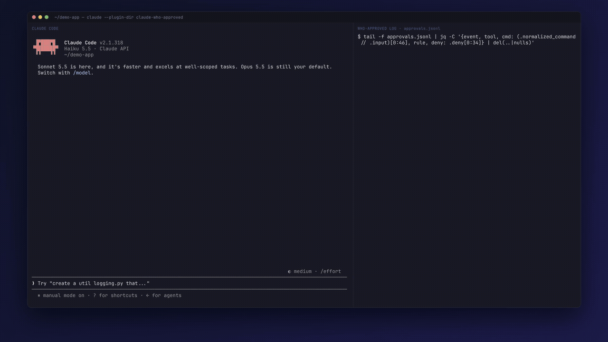

# who-approved

> **Every tool call Claude Code runs, and who said yes to it.**

A Claude Code mod that writes one JSONL line per tool call (every tool, not only Bash), naming **who let it through**: a hook, a settings rule, the auto-mode classifier, a person, or Claude Code itself.

Claude Code shows none of these allows in the UI. One file now answers *"why did this call run?"*

- 🔍 **Every tool** — Bash, Edit, MCP, all of them.
- 🪶 **Log only** — never allows, denies or rewrites a call.
- 🏠 **Local** — a plain file on your disk. Nothing leaves the machine.



```json
{"ts":"2026-11-06T09:41:12Z","event":"approval:classifier:ran","source":"who-approved","tool":"Bash","normalized_command":"git push -u origin main","permission_mode":"auto","tool_use_id":"toolu_01Ab…"}
{"ts":"2026-11-06T09:41:30Z","event":"approval:settings_rule:ran","source":"who-approved","tool":"Bash","normalized_command":"bun test","rule":"Bash(bun test:*)","tool_use_id":"toolu_01Cd…"}
{"ts":"2026-11-06T09:42:03Z","event":"approval:user:denied","source":"who-approved","tool":"Bash","normalized_command":"rm -rf dist","deny":"The user doesn't want to proceed…","tool_use_id":"toolu_01Ef…"}
```

## Contents

- [Install](#install)
- [Who can approve](#who-can-approve)
- [Where it writes](#where-it-writes)
- [Recipes](#recipes)
- [Config](#config)
- [Log schema](#log-schema)
- [Limits](#limits)
- [Develop](#develop)

## Install

Needs function hooks (`CLAUDE_CODE_ENABLE_FUNCTION_HOOKS=1` where not on by default).

```bash
claude plugin marketplace add aqaurius6666/claude-who-approved
```

```bash
claude plugin install who-approved@who-approved
```

Or for one session from a checkout:

```bash
claude --plugin-dir /path/to/claude-who-approved
```

## Who can approve

`decided_by` — the middle part of each line's `event`:

| `decided_by` | Meaning |
| --- | --- |
| `hook` | A PreToolUse hook decided (allow or deny). |
| `settings_rule` | A `permissions` rule in settings decided; `rule` names it. |
| `classifier` | The call was an `ask` and auto mode was on, so the auto-mode classifier decided. |
| `user` | A person answered the dialog (a hook's `ask` always goes to a person). |
| `core` | Claude Code allowed it by itself (for example a read-only tool). |
| `user_or_classifier` / `unknown` | The mode or the verdict was not visible. |

## Where it writes

```
~/.claude/.log/who-approved/<project>/approvals.jsonl
```

- `~/.claude` is `$CLAUDE_CONFIG_DIR` when set.
- `<project>` is the folder name Claude Code uses under `~/.claude/projects/` (the cwd with every non-alphanumeric turned into `-`).

## Recipes

Follow live:

```bash
tail -f ~/.claude/.log/who-approved/<project>/approvals.jsonl \
  | jq -c '{event, permission_mode, tool, cmd: (.normalized_command // .input)[0:80]}'
```

Count calls by who approved them:

```bash
jq -r '.event' ~/.claude/.log/who-approved/*/approvals.jsonl | sort | uniq -c | sort -rn
```

What did the classifier let through?

```bash
jq -c 'select(.event == "approval:classifier:ran") | {ts, tool, cmd: .normalized_command}' \
  ~/.claude/.log/who-approved/*/approvals.jsonl
```

Everything that was denied, and why:

```bash
jq -c 'select(.event | endswith(":denied")) | {ts, event, tool, deny}' \
  ~/.claude/.log/who-approved/*/approvals.jsonl
```

## Config

Optional. In your **user** `settings.json` (`~/.claude/settings.json`), under `pluginConfigs.who-approved.options`:

```json
{
  "pluginConfigs": {
    "who-approved": {
      "options": {
        "logDir": "~/audit/claude",
        "inputMax": 400,
        "excludeTools": ["Read", "Glob", "Grep"]
      }
    }
  }
}
```

| Key | Default | Meaning |
| --- | --- | --- |
| `logDir` | `~/.claude/.log/who-approved` | Folder that holds `<project>/approvals.jsonl`. Absolute or `~/...`. |
| `inputMax` | `400` | Characters of command or tool input to keep per line. `0` keeps none. |
| `includeTools` | all tools | Log only these tools, e.g. `["Bash", "mcp__github__*"]`. Exact names; `*` matches any characters. Case-sensitive. |
| `excludeTools` | none | Never log these tools, e.g. `["Read", "mcp__*"]`. Same matching. Applied after `includeTools`. |

- Read from **user**, **project**, **local**, **flag** (`--settings`) and **policy** (managed) settings. The last of user → project → local → flag → policy setting a key wins.
- Read once per session. Restart Claude Code after an edit.
- A bad value shows a toast and falls back to the default.

> [!WARNING]
> **Project and local settings can override the log.** A cloned repo's `.claude/settings.json` can move the log or blank the commands. Pin `logDir` in policy settings if that matters.

## Log schema

Each line has `"source": "who-approved"`. Empty fields are left out.

| Field | Meaning |
| --- | --- |
| `event` | `approval:<decided_by>:<outcome>`, e.g. `approval:user:denied`. `outcome`: `ran` or `denied` (a tool that ran and failed is still `ran`). |
| `permission_mode` | The session's mode when the call ran, if known. |
| `rule`, `hook`, `plugin`, `setting`, `reason` | What stood behind the verdict. |
| `deny` | The refusal text when `denied`, up to `inputMax` characters. |
| `normalized_command` / `input` | The Bash command, or the other tool's input as JSON, up to `inputMax` characters. |
| `tool`, `tool_use_id`, `session` | Which call. |
| `ts` | When the call ended (RFC 3339, UTC). |

## Limits

Built and tested for **auto mode**.

> [!CAUTION]
> **The log holds command text.** A command that contains a secret leaks it into the local file. Set `inputMax: 0` to keep none.

**Managed (enterprise) orgs**

- A higher-tier security plugin can skip this mod's classic hooks (`UserPromptSubmit`, `PermissionRequest`, `PermissionDenied`) and its `prompt.attachment` hook. Claude Code then shows a "hook was skipped" notice per skipped event — expect one per prompt. Only `session.start`, `tool.check` and `tool.call` run.

**Accuracy**

- **Classifier vs. user is told apart by the mode, not read directly.** With the classic events skipped, the mode comes only from `permissions.defaultMode` at session start. A session in another mode (started in default, or switched with Shift+Tab) logs the wrong `permission_mode`, and calls a person approved show as `classifier`.
- **A classifier denial may not be logged as `classifier`.** It depends on the `PermissionDenied` classic event.
- **A user's "No" is detected by its fixed message.** Without it, the outcome is `ran`.
- **`session` can name the wrong session** when several sessions run in one project. Join lines on `tool_use_id`, not `session`.
- Calls from Claude Code's helper agents (for example prompt suggestions) can show as `unknown`.

**Writes**

- A write can be lost: a toast says so, and that call's line is missing.

## Develop

| Command | What |
| --- | --- |
| `bun test` | `tests/*.spec.ts`, pure logic |
| `claude plugin test .` | `tests/*.test.ts`, against the engine |
| `bun x tsc -p .` | Type check |
| `claude plugin validate .` | Validate the plugin |

Types come from `/plugin-types` into `.claude/types/` (git-ignored, regenerate per Claude Code version).

Layout:

- `hooks/config.ts` — settings → log dir, `inputMax`, tool filters.
- `hooks/who-approved.ts` — the hooks and the log line.
